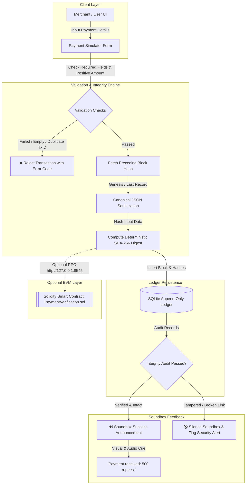

# Blockchain-Based Payment Verification and Soundbox Simulation System

[](https://www.python.org/downloads/)
[](https://streamlit.io/)
[](https://www.sqlite.org/)
[](https://en.wikipedia.org/wiki/SHA-2)
[](https://pytest.org/)

An academic, software-only prototype inspired by digital payment soundboxes (such as Paytm / PhonePe Soundbox) combined with a cryptographically linked append-only ledger (blockchain architecture).

---

> ### ⚠️ Academic & Educational Disclaimer
> **THIS IS AN EDUCATIONAL PROTOTYPE FOR ACADEMIC EVALUATION ONLY.**
> - It is **NOT** an official Paytm, PhonePe, UPI, or NPCI product.
> - It does **NOT** connect to real bank accounts, real merchant terminals, UPI switches, or real-world money.
> - All payments are strictly simulated.
> - A locally generated SHA-256 hash confirms cryptographic sequence integrity and tamper-evidence on this machine; **it does not constitute bank authorization or legal fiat financial settlement**.

---

## 1. System Architecture

The application combines a payment simulation frontend, deterministic canonical JSON hashing, an append-only SQLite blockchain ledger, and a simulated voice/visual soundbox interface.



---

## 2. Key Features

- **Interactive Payment Simulator**:
  - Validates positive amounts (`amount > 0`), non-empty transaction IDs, and sender identifiers.
  - Automatically rejects duplicate transaction IDs.
  - Clearly labels all records as simulated transactions.
  - Provides instant sample transaction generation for live demonstrations.

- **Blockchain-Style Append-Only Ledger**:
  - Deterministic serialization using canonical sorted JSON keys and normalized numerical formatting.
  - Sequential SHA-256 cryptographic linkage: each block contains the `current_hash` of its payload and the `prev_hash` of the preceding block.
  - Genesis block anchored to a 64-character zero string (`0000000000000000000000000000000000000000000000000000000000000000`).
  - Persistent SQLite database preserving data across application restarts.

- **Dynamic Soundbox Simulation**:
  - Dedicated visual soundbox hardware interface with status LED, speaker grill, LCD amount display, and sound wave animations.
  - Dynamic announcement: `"Payment received: {amount} rupees."`
  - Dual-engine audio: Google Text-to-Speech (online), pyttsx3 (offline Windows SAPI), and in-browser Web Speech API button for zero-latency instant replay.
  - **Security Guard**: Will **never** announce unverified or tampered transactions.

- **Controlled Tampering Sandbox**:
  - Isolated test environment using in-memory copies to demonstrate cryptographic sensitivity without damaging the real database.
  - Demonstrates the avalanche effect of SHA-256 and detects broken hash links.
  - Includes an attacker chain rewrite simulation button showing computational overhead.

- **Full Verification Suite**:
  - Verify individual transactions by Tx ID.
  - Audit the full SQLite database on demand with instant diagnostics.

- **Automated Test Suite**:
  - 18 comprehensive pytest tests covering input validation, hashing determinism, link continuity, database persistence, and tamper detection.

---

## 3. Project Directory Structure

```text
re project/
│
├── app.py                      # Main Streamlit web application & UI dashboard
├── database.py                 # SQLite database initialization, queries, and metrics
├── payment_simulator.py        # Payment processing, input validation, and sample generators
├── blockchain_ledger.py        # SHA-256 canonical hashing and full-chain verification
├── verification.py             # Transaction verification logic & limitation disclosures
├── soundbox.py                 # Visual soundbox component & Text-to-Speech synthesizer
├── tampering_demo.py           # Isolated sandbox for demonstrating tampering detection
├── config.py                   # Central constants, templates, and directory paths
├── blockchain_contract.py      # Optional Web3.py connector for local smart contract
├── requirements.txt            # Python dependencies
├── pytest.ini                  # Pytest configuration
├── .gitignore                  # Git ignore rules
│
├── tests/                      # Automated test suite
│   ├── test_payments.py        # Tests for input validation, duplicates, and soundbox
│   ├── test_ledger.py          # Tests for hashing, genesis link, and tamper detection
│   ├── test_verification.py    # Tests for single-tx & full-ledger audits
│   └── test_blockchain_contract.py # Tests for optional Web3 connector
│
├── contracts/                  # Optional EVM smart contracts
│   └── PaymentVerification.sol # Solidity contract for anchoring hashes on-chain
│
├── scripts/                    # Optional deployment scripts
│   └── deploy_contract.js      # Hardhat deployment script
│
├── data/                       # Persistent SQLite database storage
└── audio_cache/                # Cached announcement audio files
```

---

## 4. Windows Installation and Execution Guide

### Step 1: Verify Python Installation
Open PowerShell or Command Prompt and run:
```powershell
python --version
```
*Ensure Python 3.11 or higher is installed.*

### Step 2: Create a Virtual Environment
Navigate to the project root directory and create a virtual environment:
```powershell
python -m venv .venv
```

### Step 3: Activate the Virtual Environment
```powershell
.venv\Scripts\activate
```
*(Your terminal prompt will now show `(.venv)`)*

### Step 4: Install Dependencies
```powershell
python -m pip install -r requirements.txt
```

### Step 5: Run Automated Tests
Verify all 18 automated tests pass:
```powershell
.venv\Scripts\pytest -v
```

### Step 6: Launch the Streamlit Web Dashboard
```powershell
.venv\Scripts\streamlit run app.py
```
Streamlit will automatically open the dashboard in your default browser at `http://localhost:8501`.

---

## 5. Troubleshooting Common Issues

| Issue / Error | Cause | Solution |
| :--- | :--- | :--- |
| `Python was not found` | Microsoft Store execution alias enabled | Disable App Execution Alias in Windows Settings or run via `.venv\Scripts\python.exe` |
| `No module named 'database'` | Root directory missing from Python path | Run pytest via `.venv\Scripts\pytest -v` (configured via `pytest.ini`) |
| Audio does not play automatically | Modern browser autoplay restrictions | Click the **"🎙️ Replay Voice Announcement"** button on the Soundbox component |
| Duplicate Transaction ID error | Attempted to submit an already recorded `tx_id` | Check the **Random ID** box or enter a new unique transaction identifier |
| Database corrupted during testing | Manual database edit | Click **"🗑️ Reset Ledger Database"** in the sidebar to reset cleanly |

---

## 6. Optional Local Blockchain Integration (EVM / Hardhat)

The system works 100% offline using its local SQLite blockchain ledger. To optionally anchor hashes on an EVM smart contract:

1. **Install Node.js & Hardhat** (in a separate terminal):
   ```bash
   npm install --save-dev hardhat @nomicfoundation/hardhat-toolbox
   ```
2. **Start a local development blockchain node**:
   ```bash
   npx hardhat node
   ```
   *(Node starts listening on `http://127.0.0.1:8545`)*
3. **Deploy the contract**:
   ```bash
   npx hardhat run scripts/deploy_contract.js --network localhost
   ```
4. The Python connector (`blockchain_contract.py`) will automatically discover the deployed contract address and anchor transaction hashes on the local testnet.

---

## 7. Complete Project Report Outline

This outline can be used directly for your final academic project report or seminar documentation:

1. **Abstract**:
   Overview of digital payment notification devices (soundboxes), fraud vulnerabilities, and how append-only cryptographic ledgers provide tamper-evident local audit records.
2. **Introduction & Objectives**:
   Need for transparent payment confirmation, simulation of UPI/QR transactions, detection of duplicate IDs and payload tampering, and dynamic voice feedback.
3. **Existing System vs. Proposed System**:
   - *Existing System*: Centralized cloud webhooks without local verifiable audit chains; merchant devices depend completely on external server trust.
   - *Proposed System*: Cryptographically chained local ledger using SHA-256; mathematical tamper detection; audible soundbox validation.
4. **Theoretical Background & Mathematical Formulation**:
   - Cryptographic Hash Functions ($H(M) \in \{0, 1\}^{256}$)
   - Avalanche effect and pre-image resistance
   - Linked lists of hashes: $B_i = H(\text{payload}_i \parallel H(B_{i-1}))$
5. **System Architecture & Data Flow**:
   Modular decomposition (UI, Simulation Engine, Crypto Ledger, Soundbox Synthesizer, Verification Service).
6. **Database Schema & Design**:
   SQLite schema, constraints, unique indexing on `tx_id`, and WAL concurrency mode.
7. **Implementation Details**:
   Canonical serialization algorithms, deterministic hashing, gTTS/pyttsx3 speech pipelines, and Streamlit state management.
8. **Experimental Results & Testing**:
   Execution of 18 automated test cases, performance benchmarking, and sandbox tampering demonstration.
9. **Security Analysis & Limitations**:
   Distinction between single-node cryptographic chains vs. decentralized peer-to-peer consensus; inability of local hashes to substitute for bank settlement.
10. **Conclusion & Future Enhancements**:
    Integration with hardware IoT microcontrollers (ESP32 / Raspberry Pi), cellular MQTT brokers, and production zero-knowledge rollups.

---

## 8. License

This project is created for educational and academic purposes under the MIT License.
